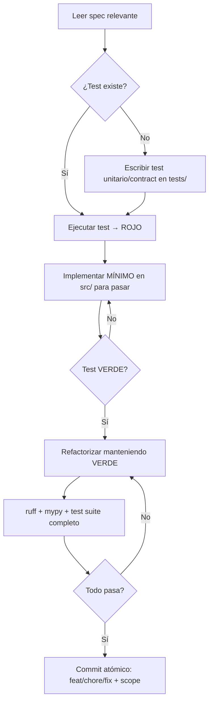

# AGENTS.md — Instrucciones Maestras para Agente CLI (Spec-Driven Development)

> **Single Source of Truth** para la implementación del sistema **MathTutor-AI**.
> Este documento gobierna *cómo* el agente de código (Claude Code / Codex CLI) debe trabajar.
> Las especificaciones técnicas detalladas residen en `specs/*.md` y son **ley vinculante**.

---

## 1. Identidad del Proyecto

| Atributo | Valor |
|----------|-------|
| **Nombre** | `mathtutor-ai` |
| **Dominio** | Tutoría matemática Bachillerato/EvAU (Matemáticas II: Cálculo) |
| **Arquitectura** | Sistema agéntico híbrido (LLM + herramientas deterministas SymPy) con memoria en Knowledge Graph (Neo4j) |
| **Interfaces** | API REST (FastAPI) + Web UI (HTMX/Alpine.js) + CLI administrativo |
| **Stack Principal** | Python 3.11+, FastAPI, Neo4j 5.x (Docker), SymPy, Pydantic v2, Pytest, Ruff, MyPy |

---

## 2. Reglas de Spec-Driven Development (SDD) — **Obligatorias**

### 2.1 Flujo de Trabajo Canónico
```
LEER specs/ → ESCRIBIR tests (rojos) → IMPLEMENTAR (mínimo para pasar) → REFACTORIZAR → VERIFICAR specs/ → COMMIT
```
**Nunca** implementes funcionalidad sin que exista una especificación en `specs/` y un test que la valide.

### 2.2 Jerarquía de Autoridad
1. `AGENTS.md` (este archivo) — Reglas de proceso, convenciones, prohibiciones.
2. `specs/01-domain-and-graph-schema.md` — Ontología, reglas de negocio, contratos de datos del grafo.
3. `specs/02-agent-architecture-and-workflows.md` — Máquinas de estado, flujos de agentes, transiciones.
4. `specs/03-tools-and-data-contracts.md` — Esquemas Pydantic, firmas de herramientas, capa LLM agnóstica.
5. `specs/04-testing-evals-and-infra.md` — Estrategia de testing, evals, Docker, CI/CD.

> **Regla de consistencia**: Si detectas contradicción entre specs, **detente** y pregunta. No improvises.

### 2.3 Definición de "Done" para una Espec
- [ ] Tests unitarios (`tests/unit/`) pasan (`pytest -xvs`).
- [ ] Tests de contrato (`tests/contract/`) validan esquemas Pydantic y respuestas HTTP.
- [ ] Evals relevantes (`evals/`) ejecutan sin regresión en métricas clave.
- [ ] `ruff check . --select=E,F,W,I,UP,B,C4` limpio (cero warnings).
- [ ] `mypy --strict src/` limpio (cero errores).
- [ ] Documentación actualizada (docstrings Google-style + `specs/` si cambió contrato).

---

## 3. Convenciones de Código (Python 3.11+)

### 3.1 Estilo y Linting
- **Formatter/Linter**: `ruff` (config en `pyproject.toml`). Ejecutar `ruff check --fix && ruff format` antes de commit.
- **Type Checking**: `mypy --strict` en `src/`. **Prohibido** `# type: ignore` sin justificación en comentario.
- **Imports**: `isort` profile `black` (gestionado por Ruff). Agrupación: stdlib → third-party → local.
- **Naming**: `snake_case` (vars/funcs), `PascalCase` (clases), `UPPER_SNAKE` (constantes), `_leading_underscore` (privado interno).

### 3.2 Arquitectura de Carpetas (Enforced)
```
mathtutor-ai/
├── AGENTS.md                    # Este archivo
├── specs/                       # Especificaciones (SOLO .md, sin código)
│   ├── 01-domain-and-graph-schema.md
│   ├── 02-agent-architecture-and-workflows.md
│   ├── 03-tools-and-data-contracts.md
│   └── 04-testing-evals-and-infra.md
├── src/
│   └── mathtutor/
│       ├── __init__.py
│       ├── domain/              # Entidades, value objects, reglas de negocio puras
│       │   ├── entities.py
│       │   ├── value_objects.py
│       │   ├── events.py
│       │   └── rules.py
│       ├── graph/               # Adaptador Neo4j (repositorios, mappers, queries)
│       │   ├── repositories.py
│       │   ├── mappers.py
│       │   ├── queries.cypher   # Archivos .cypher separados
│       │   └── session.py
│       ├── agent/               # Orquestación agéntica (state machines, nodes, tools)
│       │   ├── state.py
│       │   ├── nodes/
│       │   ├── tools/
│       │   └── workflows/
│       ├── llm/                 # Capa agnóstica de proveedores (Protocol + Adapters)
│       │   ├── protocol.py
│       │   ├── adapters/
│       │   └── factory.py
│       ├── ingestion/           # Pipeline OCR multimodal (Strategy pattern)
│       │   ├── pipeline.py
│       │   ├── strategies/
│       │   └── parsers/
│       ├── api/                 # FastAPI routers, dependencies, schemas
│       │   ├── routes/
│       │   ├── dependencies.py
│       │   └── schemas/
│       ├── core/                # Config, logging, exceptions, security
│       │   ├── config.py
│       │   ├── logging.py
│       │   └── exceptions.py
│       └── cli/                 # Comandos administrativos (Typer)
│           └── commands.py
├── tests/
│   ├── unit/                    # Tests unitarios puros (domain, tools, mappers)
│   ├── contract/                # Tests de contrato (Pydantic, HTTP, Cypher)
│   ├── integration/             # Tests con Neo4j real (testcontainers)
│   └── e2e/                     # Tests end-to-end (Playwright/API real)
├── evals/                       # Dataset y runners de evaluación anti-alucinación
│   ├── dataset/
│   ├── runners/
│   └── metrics/
├── docker/
│   ├── Dockerfile
│   ├── docker-compose.yml
│   └── docker-compose.test.yml
├── scripts/                     # Scripts auxiliares (seed, migraciones, benchmarks)
└── pyproject.toml
```

### 3.3 Patrones Obligatorios
| Patrón | Uso Requerido |
|--------|---------------|
| **Repository Pattern** | Todo acceso a Neo4j vía `GraphRepository` interfaces en `domain/`, implementación en `graph/`. |
| **Dependency Injection** | `FastAPI Depends` + `Protocol` para LLM, OCR, Graph. Sin instanciación directa en lógica de negocio. |
| **Result/Either Monad** | `returns.Result` o `dataclass Result[T, E]` para operaciones fallibles (OCR, LLM, SymPy). **No exceptions** para flujo controlado. |
| **Pydantic v2** | Todos los contratos de entrada/salida (API, Tools, Events, Graph DTOs) son `BaseModel` con `model_config = ConfigDict(extra='forbid', frozen=True)`. |
| **Structured Logging** | `structlog` + `logging` stdlib. Contexto: `request_id`, `user_id`, `session_id`, `agent_trace_id`. |
| **Async First** | `async def` por defecto en I/O (Neo4j, HTTP, LLM, OCR). Sync solo para CPU-bound (SymPy) → `run_in_executor`. |

---

## 4. Prohibiciones Estrictas (Hard Constraints)

| # | Prohibición | Razón |
|---|-------------|-------|
| **P1** | **LLM calculando matemáticas directamente**. Toda operación simbólica/numerica **debe** delegar a herramienta `SymPyTool` validada. | Cero alucinaciones matemáticas. |
| **P2** | **Cypher raw en lógica de negocio**. Solo en `graph/queries/*.cypher` y `graph/repositories.py`. | Separación de capas, testabilidad, migrabilidad. |
| **P3** | **Acoplamiento a proveedor LLM concreto** (ej. `import anthropic` en `agent/`). Usar `LLMProtocol` + `LLMFactory`. | Agnosticismo, evaluación de modelos, costes. |
| **P4** | **Estado mutable global** (singletons, `global` vars, módulos con estado). | Concurrencia, tests deterministas, debugging. |
| **P5** | **`print()` / `logging.basicConfig`** en código de librería. Usar `structlog.get_logger(__name__)`. | Observabilidad unificada, correlación de trazas. |
| **P6** | **Tests que modifican BD compartida**. Cada test integra su propio `neo4j` (testcontainers) o usa mocks de repositorio. | Aislamiento, paralelismo, CI fiable. |
| **P7** | **Hardcodear prompts** en nodos de agente. Prompts en `agent/prompts/` como plantillas Jinja2, versionadas. | Prompt engineering trazable, A/B testing, evals. |
| **P8** | **Ignorar `mypy --strict`**. Si un error de tipos es "demasiado estricto", refactoriza el código, no lo silencies. | Corrección estática, refactoring seguro. |

---

## 5. Comandos de Desarrollo (Makefile / Just / Taskfile)

> Ejecuta desde la raíz del repo. **Documenta cualquier comando nuevo aquí.**

```bash
# ── Setup ──────────────────────────────────────────────────────────────
make install           # pip install -e ".[dev]" + pre-commit install
make up                # docker compose up -d (Neo4j, Redis, etc.)
make down              # docker compose down -v

# ── Calidad de Código ──────────────────────────────────────────────────
make lint              # ruff check . --select=E,F,W,I,UP,B,C4
make format            # ruff format .
make typecheck         # mypy --strict src/
make check             # lint + typecheck + tests unit (rápido)

# ── Tests ──────────────────────────────────────────────────────────────
make test              # pytest -xvs tests/unit tests/contract
make test-int          # pytest -xvs tests/integration (requiere Neo4j testcontainer)
make test-e2e          # pytest -xvs tests/e2e (requiere API arriba)
make test-all          # test + test-int + test-e2e

# ── Evals (Anti-alucinación) ───────────────────────────────────────────
make eval              # python -m evals.runners.full_suite
make eval-quick        # python -m evals.runners.quick_smoke

# ── Desarrollo ─────────────────────────────────────────────────────────
make dev               # uvicorn mathtutor.api.main:app --reload --port 8000
make cli               # python -m mathtutor.cli --help
make seed              # python scripts/seed_graph.py (datos curriculares base)

# ── CI Local (simula GitHub Actions) ───────────────────────────────────
make ci                # check + test + eval-quick + build-docker
```

---

## 6. Flujo de Trabajo del Agente CLI (Tu Día a Día)

### 6.1 Inicio de Sesión
```bash
# 1. Levantar infra
make up

# 2. Verificar estado
make check

# 3. Leer la spec objetivo (ej. specs/02-agent-architecture-and-workflows.md)
# 4. Identificar el siguiente test rojo a implementar
```

### 6.2 Ciclo de Implementación (Por Spec)


### 6.3 Commits (Conventional Commits + Scope)
```
feat(agent): add derivative correction node with SymPy validation
fix(graph): handle null prerequisite in cypher query
test(domain): add value object tests for LatexExpression
eval: extend dataset with chain rule error patterns
docs(specs): update 03-tools-contracts with OCR fallback schema
chore(deps): upgrade sympy to 1.13
```
**Scope obligatorio**: `domain`, `graph`, `agent`, `llm`, `ingestion`, `api`, `cli`, `eval`, `infra`, `deps`.

### 6.4 Antes de Push / PR
```bash
make ci   # Debe pasar completo. Si falla, no haces push.
```

---

## 7. Configuración de Entorno (.env.example)

```bash
# ── Neo4j ──────────────────────────────────────────────────────────────
NEO4J_URI=bolt://localhost:7687
NEO4J_USER=neo4j
NEO4J_PASSWORD=mathtutor-dev
NEO4J_DATABASE=neo4j

# ── LLM Providers (al menos uno configurado) ───────────────────────────
# Anthropic
ANTHROPIC_API_KEY=
ANTHROPIC_MODEL=claude-3-5-sonnet-20241022

# OpenAI
OPENAI_API_KEY=
OPENAI_MODEL=gpt-4o-2024-08-06

# Ollama (Local)
OLLAMA_BASE_URL=http://localhost:11434
OLLAMA_MODEL=llama3.1:70b

# Active provider: "anthropic" | "openai" | "ollama"
LLM_PROVIDER=anthropic

# ── OCR Strategies ─────────────────────────────────────────────────────
# Local (requiere GPU + modelos descargados)
OCR_LOCAL_ENABLED=true
OCR_LOCAL_MODEL=pix2text  # o nougat, surya
OCR_LOCAL_DEVICE=cuda     # cuda | cpu

# Fallback API
OCR_FALLBACK_ENABLED=true
OCR_FALLBACK_PROVIDER=mathpix  # mathpix | anthropic | openai
MATHPIX_APP_ID=
MATHPIX_APP_KEY=

# ── App ────────────────────────────────────────────────────────────────
APP_ENV=development
APP_HOST=0.0.0.0
APP_PORT=8000
LOG_LEVEL=DEBUG
SECRET_KEY=dev-secret-change-in-prod
```

---

## 8. Métricas de Calidad Objetivo (Definition of Ready para Release)

| Métrica | Target | Medición |
|---------|--------|----------|
| Cobertura unit + contract | **≥ 90%** | `pytest --cov=mathtutor --cov-fail-under=90` |
| Cobertura integration | **≥ 70%** | `pytest --cov=mathtutor --cov-fail-under=70 tests/integration` |
| Precision@1 (Detección error EvAU) | **≥ 0.92** | `evals/runners/precision_recall.py` |
| Recall@1 (Detección error EvAU) | **≥ 0.88** | `evals/runners/precision_recall.py` |
| Latencia P95 corrección ejercicio | **< 3.0s** | `evals/runners/latency.py` (SymPy + LLM) |
| Tasa alucinación matemática | **0%** | `evals/runners/hallucination_check.py` (SymPy oracle) |
| Tiempo arranque cold-start (Docker) | **< 15s** | `docker compose up` + healthcheck |

---

## 9. Referencias Rápidas a Specs (Índice)

| Spec | Qué Responde | Cuándo Consultar |
|------|--------------|------------------|
| `specs/01-domain-and-graph-schema.md` | Entidades, nodos, relaciones, propiedades, constraints, queries clave, reglas de negocio | Modelado de datos, migraciones, repositorios, validaciones de dominio |
| `specs/02-agent-architecture-and-workflows.md` | State machines, nodos de agente, transiciones, eventos, compensation, human-in-the-loop | Orquestación, nuevos flujos, debugging de ejecuciones |
| `specs/03-tools-and-data-contracts.md` | Esquemas Pydantic (API, Tools, Events), SymPyTool spec, LLMProtocol, OCRStrategy | Contratos de entrada/salida, nueva herramienta, cambio de proveedor LLM |
| `specs/04-testing-evals-and-infra.md` | Estructura tests, fixtures, testcontainers, dataset evals, Docker, CI/CD | Añadir tests, configurar eval, despliegue, performance |

---

## 10. Contacto / Escalation

- **Arquitecto (Tú)**: Decisiones de trade-off, aprobaciones de spec change, revisión de PRs complejos.
- **Agente CLI (Yo)**: Implementación fiel a specs, detección temprana de inconsistencias, propuesta de refactors.
- **Regla de oro**: **Si la spec no lo cubre, no se implementa. Se discute, se documenta en spec, luego se implementa.**

---

## 11. Forma de trabajar y Memoria

> **Obligatorio**: Lee estos archivos **antes de tocar código** en cada sesión.

### 11.1 Archivos de Referencia Obligatoria
| Archivo | Propósito | Cuándo Leer |
|---------|-----------|-------------|
| `docs/constitution.md` | Principios constitucionales del proyecto (si existe) | Inicio de sesión |
| `MEMORY.md` | Memoria de trabajo: estado actual, decisiones, deuda técnica, próximos pasos | **Siempre** al inicio |
| `specs/NNN-*/` | Spec activa (ej. `specs/02-agent-architecture-and-workflows.md`) | Antes de implementar |

### 11.2 Reglas de Memoria
- **Cambios pequeños y enfocados**: Una tarea = un commit atómico.
- **Al terminar una tarea**: Actualiza `MEMORY.md` con:
  - Qué se completó (checklist)
  - Decisiones técnicas nuevas
  - Issues/deuda técnica descubierta
  - Próximos pasos priorizados
- **No confíes en la memoria del modelo**: `MEMORY.md` es la fuente de verdad persistente.

### 11.3 Skills (Extensiones del Agente)
- Carpeta: `skills/` (una subcarpeta por skill)
- Estructura mínima por skill:
  ```
  skills/
  └── mi-skill/
      ├── skill.yaml        # Metadatos: name, description, triggers
      ├── instructions.md   # Instrucciones específicas
      └── scripts/          # Opcional: helpers
  ```
- Para usar una skill: `skill <skill-id>` o se auto-carga si match en `triggers`.
- Skills instaladas: **ninguna por defecto** (carpeta vacía). Se añadirán bajo demanda.

---

*Última actualización: 2026-11-26 — Versión 1.0.0 (Baseline para MVP)*
