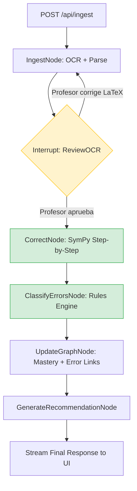
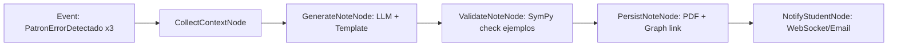

# specs/02-agent-architecture-and-workflows.md — Arquitectura Agéntica, Máquinas de Estado y Flujos

> **Single Source of Truth** para la orquestación del sistema agéntico.
> Gobierna: StateGraph LangGraph, nodos, transiciones, compensaciones, human-in-the-loop, prompt management.
> **Versión**: 1.0.0 — Baseline MVP (Matemáticas II: Cálculo)

---

## 1. Visión General de la Arquitectura Agéntica

### 1.1 Principios de Diseño
| Principio | Implementación |
|-----------|----------------|
| **Hybrid Deterministic-Orchestrated** | LLM orquesta (planifica, explica, redacta); SymPy valida (cálculo, equivalencia, clasificación). |
| **Stateful & Checkpointed** | LangGraph `StateGraph` con `SqliteSaver` → persistencia automática, reanudación tras fallo, time-travel debugging. |
| **Streaming-First** | Nodos emiten `StreamChunk` (progress, partial_result, tool_call) → WebSocket → HTMX `hx-ext="ws"`. |
| **Compensable Transactions** | Cada escritura en grafo tiene acción compensatoria (saga pattern) para rollback ante fallo parcial. |
| **Prompt-as-Code** | Plantillas Jinja2 versionadas en `agent/prompts/`, renderizadas con contexto tipado (Pydantic). |

### 1.2 Flujo Maestro (Happy Path)


---

## 2. Definición del Estado Global (LangGraph State)

### 2.1 Esquema de Estado (`AgentState`)

```python
# src/mathtutor/agent/state.py
from typing import Annotated, Literal, Optional
from pydantic import BaseModel, Field, ConfigDict
from langgraph.graph import StateGraph, add_messages
import uuid
from datetime import datetime

class OCRResult(BaseModel):
    model_config = ConfigDict(extra='forbid', frozen=True)
    latex_raw: str
    pasos_structurados: list[PasoMatematico]  # Value object de specs/01
    strategy_used: str
    confidence: float
    fallback_used: bool
    imagenes_paths: list[str]

class StepValidation(BaseModel):
    model_config = ConfigDict(extra='forbid', frozen=True)
    paso_numero: int
    latex_original: str
    latex_normalizado: str
    expresion_sympy: str  # str repr de sp.Expr
    es_correcto: bool
    tipo_error: Optional[str] = None  # Código PatronDeError si es_correcto=False
    mensaje_feedback: str
    sugerencia_correccion: Optional[str] = None

class ErrorClassification(BaseModel):
    model_config = ConfigDict(extra='forbid', frozen=True)
    patron_codigo: str
    paso: int
    confianza: float
    es_nueva_instancia: bool

class GraphUpdateResult(BaseModel):
    model_config = ConfigDict(extra='forbid', frozen=True)
    mastery_actualizado: dict[str, float]  # concepto_codigo -> nuevo_nivel
    errores_persistidos: list[ErrorClassification]
    recomendaciones_creadas: list[str]  # ejercicio_ids

class AgentState(BaseModel):
    model_config = ConfigDict(extra='forbid', arbitrary_types_allowed=True)
    
    # Identidad y tracking
    trace_id: str = Field(default_factory=lambda: str(uuid.uuid4()))
    request_id: str
    alumna_id: str = "alumna_principal"
    
    # Input
    ejercicio_id: str
    imagenes: list[bytes]  # Subidas multipart
    
    # Pipeline OCR
    ocr_result: Optional[OCRResult] = None
    ocr_approved: bool = False
    ocr_corrected_latex: Optional[str] = None
    
    # Corrección
    validaciones: list[StepValidation] = Field(default_factory=list)
    puntuacion_global: Optional[float] = None
    
    # Clasificación errores
    errores_clasificados: list[ErrorClassification] = Field(default_factory=list)
    
    # Actualización grafo
    graph_update: Optional[GraphUpdateResult] = None
    
    # Generación
    ejercicio_recomendado_id: Optional[str] = None
    apunte_generado_url: Optional[str] = None
    
    # Control de flujo
    current_node: str = "ingest"
    retry_count: int = 0
    max_retries: int = 3
    error: Optional[str] = None
    
    # Streaming
    stream_queue: Annotated[list, "internal"] = Field(default_factory=list, exclude=True)
```

### 2.2 Configuración del Grafo LangGraph

```python
# src/mathtutor/agent/workflows/main_graph.py
from langgraph.graph import StateGraph, END
from langgraph.checkpoint.sqlite import SqliteSaver
from mathtutor.agent.state import AgentState
from mathtutor.agent.nodes import (
    IngestNode, ReviewOCRNode, CorrectNode, 
    ClassifyErrorsNode, UpdateGraphNode, GenerateRecommendationNode
)

def build_main_graph() -> StateGraph:
    workflow = StateGraph(AgentState)
    
    # Nodos
    workflow.add_node("ingest", IngestNode())
    workflow.add_node("review_ocr", ReviewOCRNode())
    workflow.add_node("correct", CorrectNode())
    workflow.add_node("classify_errors", ClassifyErrorsNode())
    workflow.add_node("update_graph", UpdateGraphNode())
    workflow.add_node("generate_recommendation", GenerateRecommendationNode())
    
    # Edges
    workflow.set_entry_point("ingest")
    workflow.add_edge("ingest", "review_ocr")
    
    # Human-in-the-loop: interrupt aquí
    workflow.add_edge("review_ocr", "correct")
    
    workflow.add_edge("correct", "classify_errors")
    workflow.add_edge("classify_errors", "update_graph")
    workflow.add_edge("update_graph", "generate_recommendation")
    workflow.add_edge("generate_recommendation", END)
    
    # Compilación con checkpointer
    checkpointer = SqliteSaver.from_conn_string("sqlite:///checkpoints.db")
    return workflow.compile(checkpointer=checkpointer, interrupt_before=["review_ocr"])
```

---

## 3. Nodos del Agente (Implementación por Nodo)

### 3.1 `IngestNode` — Ingesta Multimodal + OCR Híbrido

**Responsabilidad**: Recibir imágenes/PDFs → ejecutar pipeline OCR → estructurar LaTeX en pasos → validar parseabilidad SymPy.

**Entrada**: `AgentState.imagenes`, `AgentState.ejercicio_id`

**Salida**: `AgentState.ocr_result` (o `error`)

**Lógica**:
```python
# src/mathtutor/agent/nodes/ingest.py
class IngestNode:
    def __init__(self, ocr_pipeline: OCRPipeline, exercise_repo: ExerciseRepository):
        self.ocr = ocr_pipeline
        self.repo = exercise_repo
    
    async def __call__(self, state: AgentState) -> AgentState:
        # 1. Recuperar ejercicio para contexto (tipo, conceptos)
        ejercicio = await self.repo.get_by_id(state.ejercicio_id)
        if not ejercicio:
            return state.model_copy(update={"error": f"Ejercicio {state.ejercicio_id} no encontrado"})
        
        # 2. Ejecutar pipeline OCR híbrido (local → fallback API)
        ocr_result = await self.ocr.process(
            images=state.imagenes,
            context={"tipo": ejercicio.tipo, "conceptos": [c.codigo for c in ejercicio.conceptos]}
        )
        
        # 3. Validar LaTeX parseable (RV-04)
        validation = validate_latex_parseable(ocr_result.latex_raw)
        if validation.is_failure():
            return state.model_copy(update={"error": f"LaTeX no parseable: {validation.error()}"})
        
        # 4. Estructurar en pasos (heurística + LLM opcional para segmentación)
        pasos = await self._structure_steps(ocr_result.latex_raw, ejercicio.tipo)
        
        return state.model_copy(update={
            "ocr_result": OCRResult(
                latex_raw=ocr_result.latex_raw,
                pasos_structurados=pasos,
                strategy_used=ocr_result.strategy,
                confidence=ocr_result.confidence,
                fallback_used=ocr_result.fallback_used,
                imagenes_paths=ocr_result.paths
            ),
            "current_node": "review_ocr"
        })
```

**Compensación**: Ninguna (solo lectura + OCR stateless).

---

### 3.2 `ReviewOCRNode` — Human-in-the-Loop (Interrupt Point)

**Responsabilidad**: Pausar ejecución → presentar LaTeX extraído al profesor → esperar aprobación/corrección.

**Entrada**: `AgentState.ocr_result`

**Salida**: `AgentState.ocr_approved`, `AgentState.ocr_corrected_latex`

**Mecanismo LangGraph**:
```python
# src/mathtutor/agent/nodes/review_ocr.py
from langgraph.types import interrupt, Command

class ReviewOCRNode:
    async def __call__(self, state: AgentState) -> Command:
        # Preparar payload para UI
        payload = {
            "trace_id": state.trace_id,
            "latex_raw": state.ocr_result.latex_raw,
            "pasos": [p.model_dump() for p in state.ocr_result.pasos_structurados],
            "confidence": state.ocr_result.confidence,
            "strategy": state.ocr_result.strategy_used,
            "fallback_used": state.ocr_result.fallback_used
        }
        
        # INTERRUPT: LangGraph serializa estado y espera resume()
        human_response = interrupt(payload)
        
        # human_response = {"action": "approve" | "correct", "corrected_latex": "..."}
        if human_response["action"] == "approve":
            return Command(update={
                "ocr_approved": True,
                "current_node": "correct"
            })
        else:
            # Validar LaTeX corregido por humano
            validation = validate_latex_parseable(human_response["corrected_latex"])
            if validation.is_failure():
                return Command(update={
                    "error": f"LaTeX corregido inválido: {validation.error()}",
                    "current_node": "review_ocr"  # Re-intent
                })
            
            pasos = await self._re_structure_steps(human_response["corrected_latex"])
            return Command(update={
                "ocr_approved": True,
                "ocr_corrected_latex": human_response["corrected_latex"],
                "ocr_result": state.ocr_result.model_copy(update={
                    "latex_raw": human_response["corrected_latex"],
                    "pasos_structurados": pasos
                }),
                "current_node": "correct"
            })
```

**API Endpoint para Resume** (FastAPI):
```python
# src/mathtutor/api/routes/agent.py
@router.post("/intentos/{trace_id}/review")
async def resume_ocr_review(trace_id: str, payload: OCRReviewPayload):
    graph = get_compiled_graph()
    config = {"configurable": {"thread_id": trace_id}}
    await graph.ainvoke(Command(resume=payload.model_dump()), config=config)
    return {"status": "resumed"}
```

---

### 3.3 `CorrectNode` — Corrección Paso a Paso con SymPy

**Responsabilidad**: Para cada paso del intento, validar corrección matemática contra solución esperada (o derivar solución canónica).

**Entrada**: `AgentState.ocr_result.pasos_structurados`, `ejercicio_id` (para solución esperada)

**Salida**: `AgentState.validaciones`, `AgentState.puntuacion_global`

**Algoritmo de Validación**:
```python
# src/mathtutor/agent/nodes/correct.py
class CorrectNode:
    def __init__(self, sympy_tool: SymPyTool, exercise_repo: ExerciseRepository):
        self.sympy = sympy_tool
        self.repo = exercise_repo
    
    async def __call__(self, state: AgentState) -> AgentState:
        ejercicio = await self.repo.get_by_id(state.ejercicio_id)
        solucion_esperada = ejercicio.solucion_canonica  # Expr SymPy serializada
        
        validaciones = []
        latex_base = state.ocr_corrected_latex or state.ocr_result.latex_raw
        
        for paso in state.ocr_result.pasos_structurados:
            # 1. Parsear LaTeX del paso a SymPy
            parse_result = self.sympy.parse_latex(paso.latex)
            if parse_result.is_failure():
                validaciones.append(StepValidation(
                    paso_numero=paso.numero,
                    latex_original=paso.latex,
                    latex_normalizado=paso.latex,
                    expresion_sympy="PARSE_ERROR",
                    es_correcto=False,
                    tipo_error="ERR-PARSE-LATEX",
                    mensaje_feedback="No se pudo interpretar la expresión matemática",
                    sugerencia_correccion="Revisa la sintaxis LaTeX"
                ))
                continue
            
            expr = parse_result.unwrap()
            
            # 2. Validar según tipo de ejercicio
            if ejercicio.tipo in ["calculo_limite", "derivar_funcion", "calcular_integral"]:
                # Comparar con paso equivalente de solución canónica
                validation = await self._validate_calculation_step(
                    expr, paso.numero, solucion_esperada, ejercicio.tipo
                )
            elif ejercicio.tipo == "optimizacion":
                validation = await self._validate_optimization_step(expr, paso.numero, ejercicio)
            else:
                validation = await self._validate_generic_step(expr, paso.numero, ejercicio)
            
            validaciones.append(validation)
        
        # 3. Calcular puntuación global (pesos por paso)
        puntuacion = self._calculate_score(validaciones, ejercicio)
        
        return state.model_copy(update={
            "validaciones": validaciones,
            "puntuacion_global": puntuacion,
            "current_node": "classify_errors"
        })
```

**Regla Crítica (P1)**: **Nunca** el LLM decide si un paso es correcto. Solo `SymPyTool` (equivalencia simbólica, simplificación, evaluación numérica).

**Herramientas SymPy Usadas** (ver specs/03):
- `sympy.parse_latex()` → parsing robusto
- `sympy.simplify(expr1 - expr2) == 0` → equivalencia simbólica
- `sympy.limit()`, `sympy.diff()`, `sympy.integrate()` → verificación canónica
- `sympy.nsimplify()` → detectar formas equivalentes numéricas

---

### 3.4 `ClassifyErrorsNode` — Motor de Reglas Determinista

**Responsabilidad**: Mapear cada `StepValidation` fallido a código `PatronDeError` usando reglas puras Python.

**Entrada**: `AgentState.validaciones` (donde `es_correcto=False`)

**Salida**: `AgentState.errores_clasificados`

**Motor de Reglas** (`src/mathtutor/agent/tools/error_classifier.py`):
```python
class ErrorClassifierEngine:
    """Motor de reglas puro (sin LLM, sin I/O). Testeable unitariamente."""
    
    REGLAS: list[tuple[Callable[[StepValidation, Expr], bool], str]] = [
        # (condición, patron_codigo)
        (lambda v, e: _detect_missing_chain_rule(v, e), "ERR-CHAIN-RULE"),
        (lambda v, e: _detect_sign_error(v, e), "ERR-SIGN-ERROR"),
        (lambda v, e: _detect_lhopital_misuse(v, e), "ERR-LHOPITAL-MISUSE"),
        (lambda v, e: _detect_limit_indeterminate_not_resolved(v, e), "ERR-LIM-INDET"),
        (lambda v, e: _detect_integral_constant_missing(v, e), "ERR-INT-CONSTANT"),
        (lambda v, e: _detect_algebraic_simplification_error(v, e), "ERR-ALGEBRA-SIMPLIFY"),
        (lambda v, e: _detect_domain_error(v, e), "ERR-DOMAIN-VIOLATION"),
        # Fallback genérico
        (lambda v, e: True, "ERR-UNCATEGORIZED"),
    ]
    
    def classify(self, validation: StepValidation, expected_expr: sp.Expr) -> ErrorClassification:
        for condition, codigo in self.REGLAS:
            if condition(validation, expected_expr):
                return ErrorClassification(
                    patron_codigo=codigo,
                    paso=validation.paso_numero,
                    confianza=0.95 if codigo != "ERR-UNCATEGORIZED" else 0.5,
                    es_nueva_instancia=False  # Se resuelve en UpdateGraphNode
                )
        # Nunca llega aquí por fallback
```

**Ejemplo de Regla** (Chain Rule):
```python
def _detect_missing_chain_rule(validation: StepValidation, expected: sp.Expr) -> bool:
    """Detecta si la derivada omite multiplicar por derivada interna."""
    if "derivada" not in validation.latex_original.lower():
        return False
    expr = sp.sympify(validation.expresion_sympy)
    # Heurística: expected tiene factor * inner_derivative que expr no tiene
    expected_factors = sp.factor(expected).as_coeff_mul()
    actual_factors = sp.factor(expr).as_coeff_mul()
    # Lógica simplificada: comparar estructura de factores
    return _has_missing_inner_derivative(expected_factors, actual_factors)
```

---

### 3.5 `UpdateGraphNode` — Transacción en Grafo (Saga Pattern)

**Responsabilidad**: Persistir `Intento`, crear `:HAS_ERROR`, actualizar `:MASTERY_LEVEL` (EWMA), crear `:RECOMMENDS`.

**Entrada**: `AgentState.errores_clasificados`, `AgentState.puntuacion_global`, `AgentState.validaciones`

**Salida**: `AgentState.graph_update`

**Patrón Saga (Compensación)**:
```python
# src/mathtutor/agent/nodes/update_graph.py
class UpdateGraphNode:
    def __init__(self, graph_repo: GraphRepository, error_repo: ErrorPatternRepository):
        self.graph = graph_repo
        self.errors = error_repo
    
    async def __call__(self, state: AgentState) -> AgentState:
        executed_steps = []  # Para compensación
        
        try:
            # 1. Persistir Intento (estado corregido)
            intento_id = await self.graph.create_intento(
                ejercicio_id=state.ejercicio_id,
                alumna_id=state.alumna_id,
                latex_final=state.ocr_corrected_latex or state.ocr_result.latex_raw,
                pasos=state.validaciones,
                puntuacion=state.puntuacion_global,
                estado="corregido"
            )
            executed_steps.append(("delete_intento", intento_id))
            
            # 2. Para cada error clasificado: upsert PatronDeError + link :HAS_ERROR
            errores_persistidos = []
            for ec in state.errores_clasificados:
                # Verificar si ya existe patrón
                patron = await self.errors.get_by_codigo(ec.patron_codigo)
                es_nueva = patron is None
                
                if es_nueva:
                    patron = await self.errors.create(
                        codigo=ec.patron_codigo,
                        nombre=self._nombre_from_codigo(ec.patron_codigo),
                        concepto_codigo=self._concepto_from_paso(ec.paso, state.ejercicio_id)
                    )
                
                # Link Intento -> PatronDeError
                await self.graph.link_intento_error(intento_id, ec.patron_codigo, ec.paso, ec.confianza)
                errores_persistidos.append(ec.model_copy(update={"es_nueva_instancia": es_nueva}))
            
            # 3. Actualizar Mastery Level por cada concepto testeado
            mastery_actualizado = {}
            ejercicio = await self.graph.get_ejercicio_with_conceptos(state.ejercicio_id)
            for test_rel in ejercicio.tests:
                concepto = test_rel.concepto
                # Calcular nuevo nivel basado en acierto en este concepto
                acierto_concepto = self._compute_concept_score(concepto.codigo, state.validaciones)
                nuevo_nivel = await self.graph.update_mastery_ewma(
                    alumna_id=state.alumna_id,
                    concepto_codigo=concepto.codigo,
                    score=acierto_concepto
                )
                mastery_actualizado[concepto.codigo] = nuevo_nivel
            
            # 4. Generar recomendación inmediata (siguiente ejercicio)
            recomendaciones = await self.graph.generate_recommendations(state.alumna_id, limit=1)
            recomendaciones_ids = [r.id for r in recomendaciones]
            
            return state.model_copy(update={
                "graph_update": GraphUpdateResult(
                    mastery_actualizado=mastery_actualizado,
                    errores_persistidos=errores_persistidos,
                    recomendaciones_creadas=recomendaciones_ids
                ),
                "current_node": "generate_recommendation"
            })
            
        except Exception as e:
            # COMPENSACIÓN: Rollback en orden inverso
            for action, param in reversed(executed_steps):
                if action == "delete_intento":
                    await self.graph.delete_intento(param)
            raise  # Re-lanzar para que LangGraph maneje retry/fallo
```

---

### 3.6 `GenerateRecommendationNode` — Generación de Ejercicio Adaptado

**Responsabilidad**: Consultar grafo → identificar concepto objetivo → generar ejercicio con LLM → validar con SymPy → persistir como `Ejercicio` + `:RECOMMENDS`.

**Entrada**: `AgentState.graph_update.recomendaciones_creadas` (o consulta fresca si vacía)

**Salida**: `AgentState.ejercicio_recomendado_id`, `AgentState.apunte_generado_url` (opcional)

**Bucle Generate-Validate-Retry**:
```python
# src/mathtutor/agent/nodes/generate_recommendation.py
class GenerateRecommendationNode:
    def __init__(self, llm: LLMProtocol, sympy_tool: SymPyTool, graph_repo: GraphRepository):
        self.llm = llm
        self.sympy = sympy_tool
        self.graph = graph_repo
    
    async def __call__(self, state: AgentState) -> AgentState:
        # 1. Obtener concepto objetivo (más débil con prereqs faltantes)
        perfil = await self.graph.get_student_profile(state.alumna_id)
        target_concept = self._select_target_concept(perfil)
        
        if not target_concept:
            return state.model_copy(update={"current_node": "done"})
        
        # 2. Generar ejercicio con LLM (prompt versionado)
        for attempt in range(state.max_retries):
            prompt = self._render_prompt("generate_exercise.j2", {
                "concepto": target_concept,
                "perfil_alumna": perfil,
                "intentos_previos": await self.graph.get_recent_attempts(state.alumna_id, 5),
                "dificultad_objetivo": self._calc_target_difficulty(perfil, target_concept)
            })
            
            response = await self.llm.generate(prompt, temperature=0.7)
            ejercicio_candidato = self._parse_llm_exercise(response)
            
            # 3. Validar con SymPy: ¿tiene solución? ¿dificultad correcta?
            validation = await self._validate_exercise_with_sympy(ejercicio_candidato, target_concept)
            
            if validation.is_success():
                # 4. Persistir y linkar
                ejercicio_id = await self.graph.create_exercise(
                    enunciado=ejercicio_candidato.enunciado,
                    tipo=target_concept.tipo_ejercicio,
                    dificultad=validation.unwrap().dificultad_calculada,
                    fuente="generado_ia",
                    conceptos=[target_concept.codigo]
                )
                await self.graph.link_recommendation(target_concept.codigo, ejercicio_id, "refuerzo", 1)
                
                # 5. Opcional: Generar apunte personalizado si hay patrones recurrentes
                apunte_url = None
                if perfil.patrones_recurrentes:
                    apunte_url = await self._generate_personalized_note(perfil, target_concept)
                
                return state.model_copy(update={
                    "ejercicio_recomendado_id": ejercicio_id,
                    "apunte_generado_url": apunte_url,
                    "current_node": "done"
                })
            
            # Reintento con feedback de validación
            state = state.model_copy(update={"retry_count": attempt + 1})
        
        return state.model_copy(update={"error": "No se pudo generar ejercicio válido tras reintentos"})
```

**Prompt Template** (`agent/prompts/generate_exercise.j2`):
```jinja2

Eres un generador de ejercicios de Matemáticas II (Cálculo) para EvAU.
Genera UN ejercicio original, resoluble, de dificultad {{ dificultad_objetivo }}/5.

CONCEPTO OBJETIVO: {{ concepto.nombre }} ({{ concepto.codigo }})
BLOQUE: {{ concepto.bloque }}
DEFINICIÓN: {{ concepto.descripcion }}

PERFIL ALUMNA:
- Mastery actual: {{ perfil_alumna.mastery[concepto.codigo] | default(0.0) }}
- Errores recientes: {{ e.codigo }}, 
- Racha aciertos: {{ perfil_alumna.racha_aciertos }}

REQUISITOS:
1. Enunciado claro, en LaTeX válido para SymPy
2. Debe tener solución analítica exacta (no numérica aproximada)
3. Dificultad calibrada: {{ dificultad_objetivo }}/5
4. Evita números extremadamente grandes/complejos
5. Incluye variable 'x' como principal

FORMATO SALIDA (JSON estricto):
{
  "enunciado_latex": "...",
  "enunciado_texto": "...",
  "solucion_canonica_latex": "...",
  "pasos_solucion": ["paso 1", "paso 2", ...],
  "metadata": {"parametros": {...}, "tags": ["evau", "{{ concepto.bloque.lower() }}"]}
}

```

---

## 4. Workflows Completos (Sub-Graphs)

### 4.1 Workflow Principal: `CorrectionWorkflow`
```python
# Ingest → ReviewOCR → Correct → ClassifyErrors → UpdateGraph → GenerateRecommendation
# Compilado con interrupt_before=["review_ocr"]
```

### 4.2 Workflow Secundario: `NoteGenerationWorkflow` (Triggered async)


### 4.3 Workflow Admin: `SeedCurriculumWorkflow` (CLI only)
```bash
make seed  # Ejecuta: LoadConcepts → CreatePrerequisites → CreateSeedExercises → VerifyDAG
```

---

## 5. Manejo de Errores, Retries y Compensaciones

### 5.1 Estrategia de Retry (Por Nodo)
| Nodo | Errores Reintentables | Max Retries | Backoff |
|------|----------------------|-------------|---------|
| `IngestNode` | OCR timeout, fallback API error | 2 | Exponencial 2s, 4s |
| `CorrectNode` | SymPy timeout (expresiones complejas) | 1 | 5s |
| `GenerateRecommendationNode` | LLM JSON inválido, SymPy validation fail | 3 | 1s, 2s, 4s |
| `UpdateGraphNode` | Neo4j transient error (deadlock, timeout) | 3 | 0.5s, 1s, 2s |

### 5.2 Compensaciones (Saga Rollback)
| Paso Fallido | Acción Compensatoria |
|--------------|---------------------|
| `UpdateGraphNode` tras `create_intento` | `delete_intento(intento_id)` |
| `UpdateGraphNode` tras `link_intento_error` | `unlink_intento_error(intento_id, patron_codigo)` |
| `UpdateGraphNode` tras `update_mastery` | `restore_mastery(alumna_id, concepto_codigo, nivel_anterior)` |
| `GenerateRecommendationNode` tras `create_exercise` | `delete_exercise(ejercicio_id)` + `unlink_recommendation` |

### 5.3 Dead Letter Queue (DLQ)
- Estados que fallan tras max_retries → persistidos en `agent_dlq` table (SQLite/PostgreSQL)
- UI admin para inspeccionar, reproducir y re-lanzar manualmente
- Alerta al profesor si DLQ > 0

---

## 6. Prompt Management (Prompt-as-Code)

### 6.1 Estructura de Archivos
```
src/mathtutor/agent/prompts/
├── templates/
│   ├── generate_exercise.j2
│   ├── generate_note.j2
│   ├── explain_error.j2
│   └── correction_feedback.j2
├── versions/
│   ├── v1.0.0/          # Baseline
│   ├── v1.1.0/          # Mejora chain rule feedback
│   └── current -> v1.1.0  # Symlink a versión activa
└── registry.py          # PromptRegistry: load, render, version
```

### 6.2 Registro y Versionado
```python
# src/mathtutor/agent/prompts/registry.py
class PromptRegistry:
    def __init__(self, base_path: Path):
        self.base_path = base_path
        self._cache: dict[str, str] = {}
    
    def render(self, template_name: str, context: dict, version: str = "current") -> str:
        key = f"{version}/{template_name}"
        if key not in self._cache:
            template_path = self.base_path / "versions" / version / template_name
            self._cache[key] = template_path.read_text(encoding="utf-8")
        
        template = Template(self._cache[key], undefined=StrictUndefined)
        return template.render(**context)
    
    def list_versions(self, template_name: str) -> list[str]:
        # Escanea versions/ para A/B testing
        ...
```

### 6.3 Variables de Contexto Tipadas (Pydantic)
Cada prompt define su `PromptContext` (Pydantic model) para validación en renderizado.

---

## 7. Streaming y UX en Tiempo Real (HTMX + WebSocket)

### 7.1 Eventos de Stream (`StreamChunk`)
```python
# src/mathtutor/agent/state.py
class StreamChunk(BaseModel):
    model_config = ConfigDict(extra='forbid', frozen=True)
    type: Literal["progress", "partial_result", "tool_call", "node_start", "node_end", "error"]
    node: str
    message: str
    data: dict | None = None
    timestamp: datetime = Field(default_factory=datetime.utcnow)
    trace_id: str
```

### 7.2 Nodos Emite Progreso (Callback LangGraph)
```python
# En cada nodo, uso de stream_queue
async def __call__(self, state: AgentState) -> AgentState:
    state.stream_queue.append(StreamChunk(
        type="node_start", node="correct", message="Iniciando corrección paso a paso...",
        trace_id=state.trace_id
    ))
    
    for i, paso in enumerate(pasos):
        state.stream_queue.append(StreamChunk(
            type="progress", node="correct", 
            message=f"Validando paso {paso.numero}/{len(pasos)}",
            data={"paso_actual": i+1, "total": len(pasos)},
            trace_id=state.trace_id
        ))
        # ... validación ...
    
    state.stream_queue.append(StreamChunk(
        type="node_end", node="correct", message="Corrección completada",
        data={"puntuacion": puntuacion}, trace_id=state.trace_id
    ))
    return state
```

### 7.3 Endpoint WebSocket (FastAPI)
```python
# src/mathtutor/api/routes/websocket.py
@router.ws("/ws/agent/{trace_id}")
async def agent_stream(websocket: WebSocket, trace_id: str):
    await websocket.accept()
    graph = get_compiled_graph()
    config = {"configurable": {"thread_id": trace_id}}
    
    async for chunk in graph.astream_events(None, config=config, version="v2"):
        if chunk["event"] == "on_chain_stream":
            # Filtrar StreamChunk del state
            for sc in chunk["data"]["chunk"].stream_queue:
                await websocket.send_json(sc.model_dump())
            chunk["data"]["chunk"].stream_queue.clear()
```

---

## 8. Observabilidad y Trazabilidad

### 8.1 Structured Logging por Nodo
```python
import structlog
logger = structlog.get_logger(__name__)

class CorrectNode:
    async def __call__(self, state: AgentState) -> AgentState:
        logger.info("correct_node.start", trace_id=state.trace_id, ejercicio_id=state.ejercicio_id, pasos=len(pasos))
        # ...
        logger.info("correct_node.complete", trace_id=state.trace_id, puntuacion=puntuacion, duracion_ms=elapsed)
        return state
```

### 8.2 Métricas Clave (Prometheus)
| Métrica | Tipo | Labels |
|---------|------|--------|
| `agent_node_duration_seconds` | Histogram | `node`, `status` (success/error) |
| `agent_ocr_confidence` | Histogram | `strategy`, `fallback_used` |
| `agent_sympy_validation_total` | Counter | `tipo_ejercicio`, `resultado` (correct/incorrect/parse_error) |
| `agent_error_classification_total` | Counter | `patron_codigo` |
| `agent_graph_update_duration_seconds` | Histogram | `operacion` (mastery, error_link, recommendation) |
| `agent_llm_generation_retries` | Counter | `workflow`, `success` (true/false) |

---

## 9. Testing de Workflows (Estrategia)

### 9.1 Unit Tests por Nodo (Mocks de Dependencias)
```python
# tests/unit/agent/nodes/test_correct_node.py
async def test_correct_node_detects_chain_rule_error():
    # Arrange
    sympy_mock = AsyncMock(SymPyTool)
    sympy_mock.parse_latex.return_value = Success(sp.parse_latex(r"\frac{d}{dx}\sin(x^2)"))
    sympy_mock.diff.return_value = Success(2*x*sp.cos(x**2))  # Correcto
    
    # Simular respuesta alumna SIN chain rule: cos(x^2)
    sympy_mock.parse_latex.side_effect = [
        Success(sp.parse_latex(r"\cos(x^2)")),  # Paso alumna
        Success(sp.parse_latex(r"2*x*\cos(x^2)"))  # Solución canónica
    ]
    
    node = CorrectNode(sympy_tool=sympy_mock, exercise_repo=mock_repo)
    state = AgentState(..., ocr_result=OCRResult(pasos=[PasoMatematico(numero=1, latex=r"\cos(x^2)")]))
    
    # Act
    result = await node(state)
    
    # Assert
    assert result.validaciones[0].es_correcto is False
    assert result.validaciones[0].tipo_error == "ERR-CHAIN-RULE"
```

### 9.2 Contract Tests (State Transitions)
```python
# tests/contract/agent/test_workflow_transitions.py
async def test_full_correction_workflow_happy_path():
    graph = build_test_graph()  # Con checkpointer en memoria
    initial_state = AgentState(request_id="test-1", ejercicio_id="ej-001", imagenes=[b"fake"])
    
    # 1. Ingest → ReviewOCR (interrupt)
    result = await graph.ainvoke(initial_state, config={"configurable": {"thread_id": "test-1"}})
    assert result["current_node"] == "review_ocr"
    assert result["ocr_result"] is not None
    
    # 2. Resume con approve
    result = await graph.ainvoke(Command(resume={"action": "approve"}), config=config)
    assert result["current_node"] == "generate_recommendation"  # Salta al final
    assert result["puntuacion_global"] is not None
    assert result["graph_update"] is not None
```

### 9.3 Integration Tests (Neo4j Testcontainers)
```python
# tests/integration/agent/test_update_graph_node.py
@pytest.mark.integration
async def test_update_graph_node_persists_mastery_and_errors(neo4j_container):
    # Setup: seed conceptos, ejercicio, alumna
    # Ejecutar nodo real con repo real
    # Verificar en BD: Intento creado, MASTERY_LEVEL actualizado, HAS_ERROR links
    ...
```

---

## 10. Checklist de Consistencia (Pre-Commit para esta Spec)

- [x] Todos los nodos heredan de `BaseNode` con `__call__(state) -> State | Command` y emiten `StreamChunk`.
- [x] `ReviewOCRNode` es **único** `interrupt_before` en el grafo principal (`interrupt_before=["review_ocr"]`).
- [x] `CorrectNode` **nunca** usa LLM para validar matemáticas (solo SymPyTool/latex2sympy2).
- [x] `ClassifyErrorsNode` usa `ErrorClassifierEngine` (reglas puras, 0 LLM) - 7 reglas implementadas.
- [x] `UpdateGraphNode` implementa patrón Saga con `executed_steps` para rollback real (delete/unlink).
- [x] `GenerateRecommendationNode` tiene bucle `generate → validate(sympy) → retry` con max 3 (configurable).
- [x] Prompts en `agent/prompts/versions/current/`, renderizados via `PromptRegistry` (Jinja2 versionado).
- [x] 4 plantillas implementadas: `generate_exercise.j2`, `explain_error.j2`, `correction_feedback.j2`, `generate_note.j2`
- [x] `build_main_graph()` + `build_main_graph_with_deps()` con `AsyncSqliteSaver` (async checkpointer).
- [ ] WebSocket emite `StreamChunk` tipado; HTMX consume con `hx-ext="ws"`.
- [ ] Métricas Prometheus expuestas en `/metrics` por nodo.
- [ ] Tests: unit (mocks), contract (state transitions), integration (Neo4j real).

---

*Última actualización: 2026-11-26 — Versión 1.0.0 (Baseline MVP Matemáticas II)*
